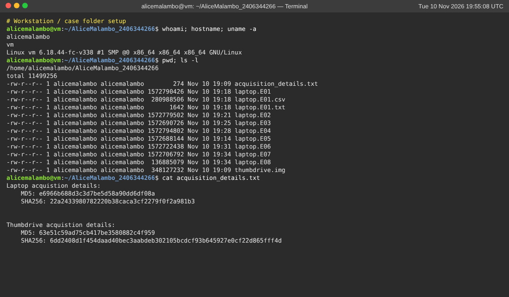
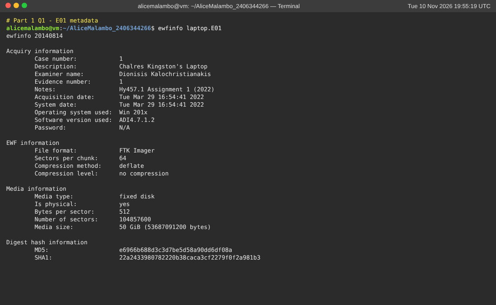
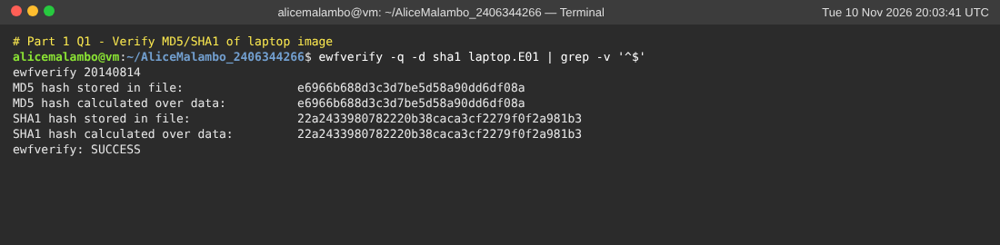
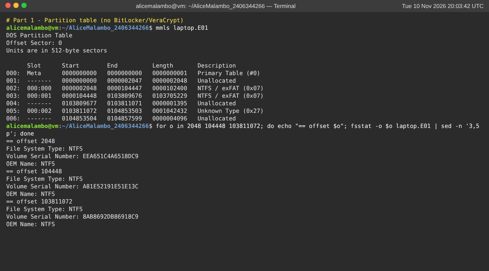
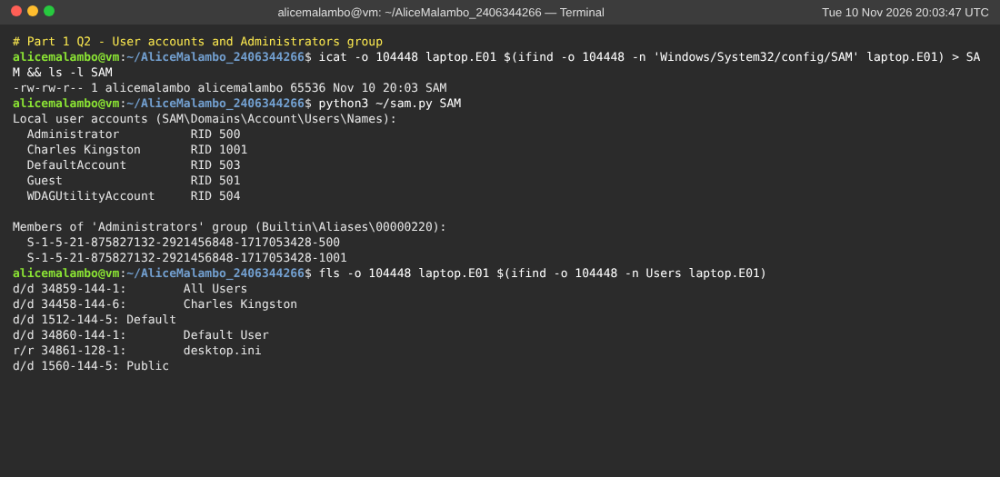
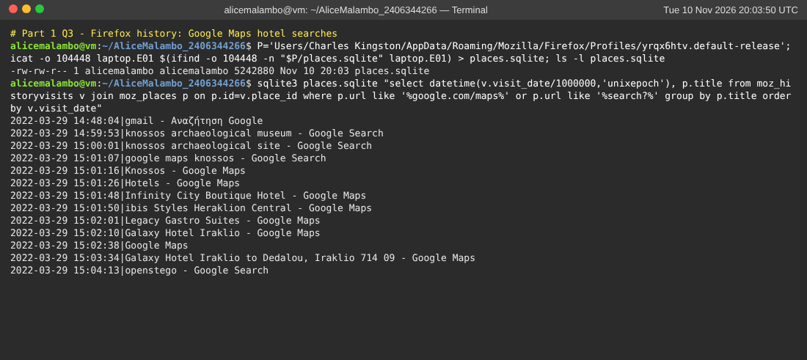
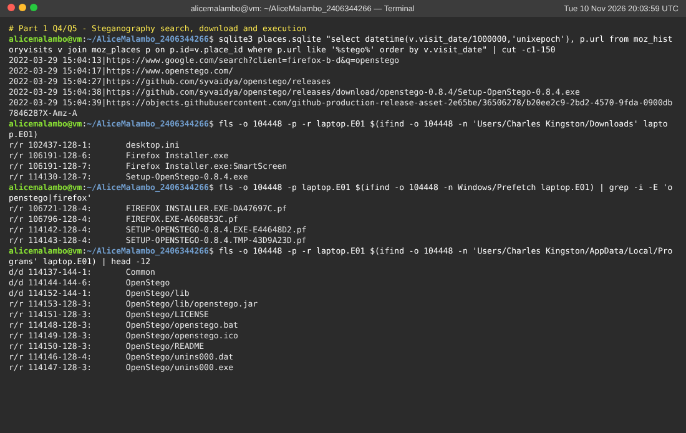
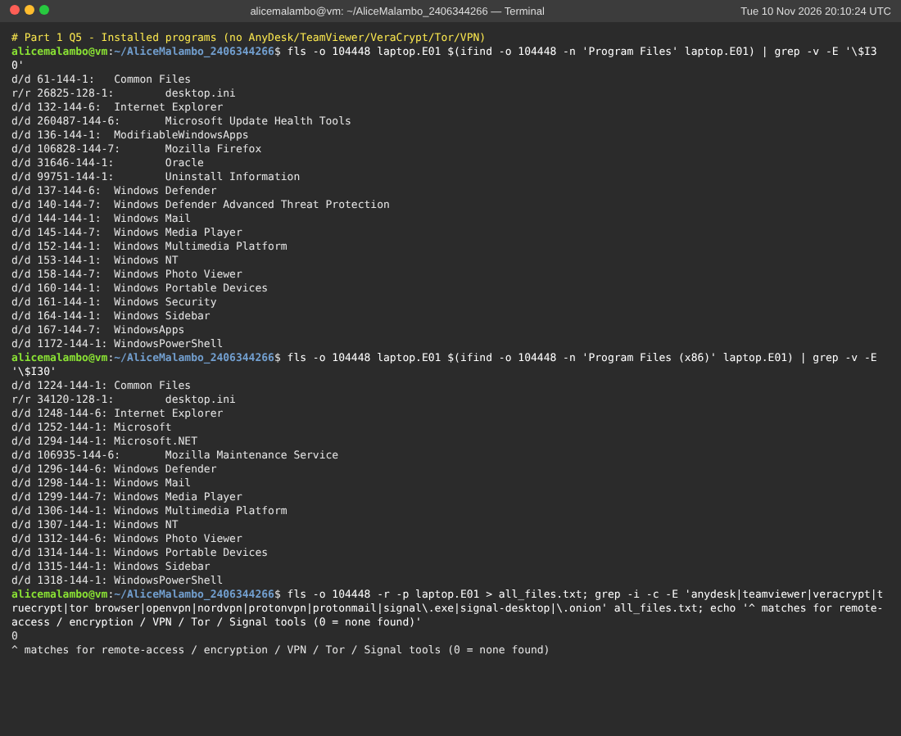
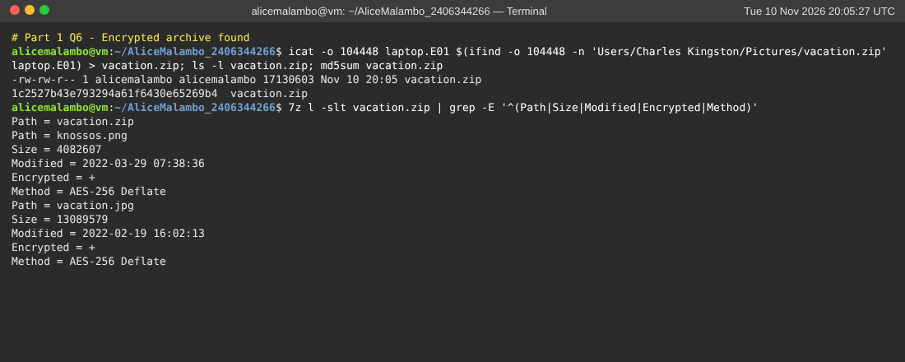

# Part 1 – Computer Analysis (laptop.E01)

> Student: Alice Malambo (SIN 2406344266). Create the Autopsy case as
> **`AliceMalambo_2406344266`** inside the folder `AliceMalambo_2406344266`,
> add `laptop.E01` as a *Disk Image* data source, and run the default ingest
> modules (Recent Activity, Hash Lookup, File Type ID, Extension Mismatch,
> Embedded File Extractor, EXIF Parser, Keyword Search, Encryption Detection).
> Take a screenshot of each Autopsy view referenced below.

## 1. Verify the integrity of the forensic image

**a/b. Commands** (Linux, or FTK Imager → *Verify Drive/Image* on Windows):

```bash
ewfinfo   laptop.E01
ewfverify -d sha1 laptop.E01
```

```
MD5 hash stored in file:          e6966b688d3c3d7be5d58a90dd6df08a
MD5 hash calculated over data:    e6966b688d3c3d7be5d58a90dd6df08a
SHA1 hash stored in file:         22a2433980782220b38caca3cf2279f0f2a981b3
SHA1 hash calculated over data:   22a2433980782220b38caca3cf2279f0f2a981b3
ewfverify: SUCCESS
```

| | Calculated | acquisition_details.txt | Match |
|---|---|---|---|
| MD5 | e6966b688d3c3d7be5d58a90dd6df08a | e6966b688d3c3d7be5d58a90dd6df08a | ✅ |
| SHA1 | 22a2433980782220b38caca3cf2279f0f2a981b3 | 22a2433980782220b38caca3cf2279f0f2a981b3 (labelled "SHA256" in the file, but a 40-hex-digit value is a SHA-1) | ✅ |

The hashes are computed over the 50 GiB of acquired data, not over the
`.E01–.E08` container files. They match the values recorded by FTK Imager
4.7.1.2 at acquisition time (29 Mar 2022, examiner D. Kalochristianakis).
The image was therefore **not altered** after acquisition. Autopsy shows the
same check under *Data Source → right-click → Run Ingest → Data Source
Integrity*.

**c. Why hash verification matters in an IT audit:**
- **Integrity and admissibility:** it proves that the evidence analysed is
  bit-for-bit identical to what was seized. Without this, findings can be
  challenged as tampered with or contaminated.
- **Chain of custody:** each hand-over can be checked against the original
  hash, so accountability is preserved.
- **Repeatability:** a second auditor can reproduce the results from the
  same verified data. This supports independence and objectivity
  (ISACA ITAF / IS Audit Standard 1205 *Evidence*).
- **Detects silent corruption** from transfers, storage or faulty media.
- **Regulatory requirements:** ISO/IEC 27037 and ISO 27001 A.5.28
  (collection of evidence) require evidence to be collected and kept in a
  verifiable state.

## 2. Windows user account

Autopsy: *Data Artifacts → Operating System User Account* and
*OS Info*. CLI: `fls`/`icat` to pull `Windows/System32/config/SAM`, then
open it with RegRipper (`rip.pl -r SAM -p samparse`) or Registry Explorer.

| Item | Value |
|---|---|
| OS | Windows 10 Pro 21H2 (build 19044), installed 28 Mar 2022 |
| Computer name | DESKTOP-IFT71NV |
| Registered owner | Charles Kingston |
| Local accounts | Administrator (500, *disabled*), Guest (501, disabled), DefaultAccount (503, disabled), WDAGUtilityAccount (504), **Charles Kingston (RID 1001)** |
| Profile | `C:\Users\Charles Kingston`, SID S-1-5-21-875827132-2921456848-1717053428-1001 |
| Logons | 8, last logon 29 Mar 2022 07:32:53 UTC |

**a. Username:** **`Charles Kingston`**. This is the only enabled interactive
account, and it owns the profile with all the user activity.

**b. Administrator privileges: yes.** The `Administrators` alias
(`SAM\Domains\Builtin\Aliases\00000220`, value `C`) has two members:
`…-500` (the built-in Administrator, which is disabled) and **`…-1001` (Charles
Kingston)**. The account's ACB flags (`0x0214`) also include
*Password-not-required* (0x0004).

**Why this is a risk:**
- The user can install any software. He installed OpenStego into his
  profile and could install VPNs or remote-access tools without approval.
- He can disable Defender, logging and auditing, and can clear event logs.
- He can make system-wide changes and create hidden accounts or persistence.
- Malware or a phishing payload running in his session runs with full
  rights.
- An auditor can no longer trust local evidence, because the user could
  alter it.
- This breaks the principle of **least privilege** (ISO 27001 A.8.2 /
  CIS Control 5 & 6 / NIST SP 800-53 AC-6). An admin account with no
  password requirement makes it worse.

## 3. Internet history

Autopsy: *Data Artifacts → Web History / Web Search / Web Form Autofill /
Web Accounts*. The primary browser is **Mozilla Firefox 98.0.2 (Greek
locale)**, installed 29 Mar 2022 14:21 UTC from Microsoft Edge. The history
file is
`Users\Charles Kingston\AppData\Roaming\Mozilla\Firefox\Profiles\yrqx6htv.default-release\places.sqlite`.

CLI check:
```bash
sqlite3 places.sqlite "select datetime(v.visit_date/1000000,'unixepoch'),p.url,p.title
  from moz_historyvisits v join moz_places p on p.id=v.place_id order by v.visit_date;"
```

Timeline (UTC, 29 Mar 2022):

| Time | Activity |
|---|---|
| 14:48 | Logs in to Gmail as **kingston.charles17@gmail.com** |
| 14:58 | CNN article: *"Canada F35 jets: Ottawa edges closer to deal with Lockheed Martin"* (military procurement) |
| 14:59–15:00 | Searches "knossos archaeological museum", "knossos archaeological site" |
| 15:01 | "google maps knossos" → Google Maps, Knossos 714 09 |
| **15:01:30** | **Google Maps search "Hotels"** around Knossos / Heraklion |
| 15:01:49 | **Infinity City Boutique Hotel** (35.3412, 25.1365) |
| 15:01:54 | **ibis Styles Heraklion Central** (35.3408, 25.1356) |
| 15:02:01 | **Legacy Gastro Suites** (35.3369, 25.1364) |
| 15:02:11–15:03:12 | **Galaxy Hotel Iraklio**, Leoforos Dimokratias (35.3305, 25.1383): viewed repeatedly |
| **15:03:34–15:03:56** | **Directions from *Galaxy Hotel Iraklio* → *Dedalou, Iraklio 714 09*** (Knossos area) |
| 15:04 | Searches "openstego", visits openstego.com and GitHub, downloads `Setup-OpenStego-0.8.4.exe` |
| 15:43–15:49 | Creates a Firefox Account / Sync with kingston.charles17@gmail.com, uses the password manager |
| 16:04–16:06 | Saves logins for facebook.com (`charlie_king@gmail.com`) and mail.google.com (`kingston.charlie17@gmail.com`) (*formhistory.sqlite*, *logins.json*) |
| 15:52 | YouTube music |

**b. Hotel searches.** The suspect looked at four hotels in Heraklion:
**Infinity City Boutique Hotel, ibis Styles Heraklion Central, Legacy Gastro
Suites and Galaxy Hotel Iraklio**. **Galaxy Hotel Iraklio (Leoforos
Dimokratias, Heraklion)** is the strongest lead. It is the hotel he spent the most
time on, and he then asked Google Maps for a route **starting at the Galaxy
Hotel** to Dedalou street near Knossos. That is what someone staying there
would do. Investigators should check its guest register first. This matters
because the USB stick was hidden in his hotel room.

**c. Private browsing / VPN.**
- **What the evidence shows:** there are no VPN clients (OpenVPN,
  WireGuard, NordVPN, ProtonVPN), no Tor Browser and no proxy settings in
  the program list, Uninstall keys, Prefetch or the file system. The only
  network adapter is the VirtualBox NAT adapter (10.0.2.15).
- **What it cannot show:** Firefox *private windows* write nothing to
  `places.sqlite`, so private browsing **cannot be ruled out**. Its use
  would show only as gaps in the history, or as traces in pagefile,
  hiberfil, DNS cache or memory. The Firefox account, Sync and saved
  passwords also mean that data may live in the cloud rather than on the
  disk.
- **Impact on an audit of internet-usage policy:** private browsing, VPNs and
  Tor make **endpoint history incomplete**. Proxy, DLP and web-filter
  logs cannot see the destinations either, so the auditor cannot show
  compliance with acceptable-use policy (AUP). Controls should therefore not
  rely on endpoint history alone:
  - Disable InPrivate/private mode through GPO.
  - Block unapproved VPN and Tor at the firewall and with application
    control.
  - Force all traffic through a logging proxy or TLS-inspecting gateway.
  - Send DNS and proxy logs to a SIEM.
  - Record any remaining gaps as a limitation of scope in the audit report.

## 4. Operational security and secure communications

| Check | Finding |
|---|---|
| i. Encrypted messaging (Signal, ProtonMail, Telegram, WhatsApp) | **None found.** No installs, no Prefetch, no AppData folders, no visits to these sites. Communication was through **Gmail** (kingston.charles17@gmail.com) and **Facebook**. |
| ii. Steganography / encryption searches | **Yes.** Firefox search **"openstego"** (15:04:13). Visits to openstego.com and the GitHub releases page. Download of `Setup-OpenStego-0.8.4.exe` (in `Downloads`, Firefox download annotation, Zone.Identifier). Prefetch files `SETUP-OPENSTEGO-0.8.4.EXE-E44648D2.pf` / `.TMP-43D9A23D.pf` prove it ran. The program was installed per-user to `AppData\Local\Programs\OpenStego`. He also created an **AES-256-encrypted ZIP** (`Pictures\vacation.zip`). |
| iii. Dark web / anonymity tools | **None found.** No Tor Browser, no `.onion` URLs, no VPN or proxy software. |

Conclusion: the evidence supports the suspicion that he was trained in
*hiding data in plain sight*. He combined **steganography (OpenStego)**,
**strong archive encryption** and **anti-forensic deletion** (the password
file was "deleted" on the USB stick). He used ordinary mainstream services
(Gmail, Facebook, a tourist-looking "vacation" archive) as cover, instead of
conspicuous tools such as Tor or Signal.

**b. Recommendations for security awareness training:**
1. Teach staff that **innocuous files can carry hidden data**: steganography
   in images, encrypted ZIPs, "vacation" photos. Back this up with DLP rules
   that flag encrypted archives and images leaving the organisation.
2. **Least privilege:** explain why users must not have admin rights or
   install unvetted tools, and how to request software.
3. **Password hygiene:** no plaintext password files, on USB sticks or
   anywhere else. Use an approved password manager and MFA.
4. **Removable media:** encrypted, company-issued USB devices only. Report
   lost media. Understand that "Delete/Trash" does not erase data.
5. **Social engineering / insider-threat awareness:** recognise and report
   unusual behaviour, such as drone photos of infrastructure, or interest in
   military news alongside data-hiding tools.
6. **Travel security:** clean devices for travel, and what to expect at
   border or airport inspections.
7. Run regular phishing and steganography exercises, and measure the
   results. Map the training to ISO 27001 A.6.3 and NIST SP 800-50.

## 5. Installed software and unauthorised applications

Sources: SOFTWARE hive `Microsoft\Windows\CurrentVersion\Uninstall` (both
views), `Program Files`, `AppData\Local\Programs`, Prefetch, UserAssist.
In Autopsy: *Data Artifacts → Installed Programs*, *Run Programs*,
*Recent Documents*.

| Program | Version | Installed (UTC) | Assessment |
|---|---|---|---|
| Microsoft Edge / Edge Update | 99.0.1150.55 | 28 Mar 2022 | built-in |
| Microsoft Update Health Tools | 3.66 | 28 Mar 2022 | built-in |
| Mozilla Firefox (x64 el) + Maintenance Service | 98.0.2 | 29 Mar 2022 14:33 | user-installed browser. Acceptable only if whitelisted |
| **OpenStego** | **0.8.4** | **29 Mar 2022 ~15:05** | **High-risk / unauthorised.** Steganography tool installed **per-user in `%LOCALAPPDATA%\Programs\OpenStego`**. This bypasses `Program Files` and does not appear in the HKLM Uninstall key |
| Oracle VM VirtualBox Guest Additions | 6.1.32 | 29 Mar 2022 16:12 | shows the "laptop" is actually a **virtual machine** |

**a. Unauthorised / high-risk:** **OpenStego**. Its only purpose is hiding and
extracting data inside images, plus watermarking. Installing it per-user is a
common way to get around software-installation controls.

**b. Remote access / encryption tools:**
- **No remote-access tools** were found: no AnyDesk, TeamViewer,
  RustDesk, VNC or RDP wrappers, and no traces in Prefetch or the file
  system.
- **Encryption / data hiding:** OpenStego, which supports AES-128/256
  encryption of the hidden payload, and the AES-256-encrypted
  `vacation.zip`.
- These artefacts point to covert exfiltration through images rather than
  through remote control.

**c. Preventing unauthorised installs in a corporate environment:**
- Remove local admin rights. Use LAPS for the built-in administrator.
- **Application allow-listing:** Microsoft AppLocker / WDAC, with rules that
  also cover `%LOCALAPPDATA%` and `%TEMP%` so that per-user installs are
  blocked.
- Use a managed software catalogue (Intune, SCCM, Company Portal) with a
  formal change-management and approval process.
- EDR/AV alerts on new executables and on known dual-use tools (stego, Tor,
  remote access).
- Block downloads of executables at the web proxy. Turn on SmartScreen in
  block mode.
- Run periodic software-inventory audits against the approved baseline,
  with a SIEM alert on Event IDs 11707/1033 (MSI installs) and 4688
  (process creation).
- Write all of this into an Acceptable Use and Software policy, with
  sanctions (ISO 27001 A.8.19 "Installation of software on operational
  systems", CIS Control 2).

## 6. Data protection and encryption compliance

**a. Encrypted files:**
- Autopsy *Encryption Detection* module and *Analysis Results → Encryption
  Detected*.
- CLI: `7z l -slt vacation.zip`.

| File | Detail |
|---|---|
| `C:\Users\Charles Kingston\Pictures\vacation.zip` (17,130,603 B, modified 29 Mar 2022 07:42 UTC; MD5 1c2527b43e793294a61f6430e65269b4) | **Password-protected ZIP, AES-256 + Deflate.** Holds `vacation.jpg` (13,089,579 B) and `knossos.png` (4,082,607 B). Opened recently (`Recent\vacation.lnk` → `..\Pictures\vacation.zip`). |
| `knossos.png` (inside the ZIP) | Candidate **steganographic carrier**. PNG is OpenStego's output format, and the file was created the same day OpenStego was used. See Part 3. |

**b. BitLocker / VeraCrypt / TrueCrypt:**
- **None.** No VeraCrypt or TrueCrypt programs, drivers or `.hc`/`.tc`
  containers were found.
- The partition table (`mmls laptop.E01`) shows:
  - a 50 MB System Reserved NTFS partition;
  - the main NTFS partition at sector 104448;
  - a 509 MB Windows Recovery partition (type 0x27).
- None of them carries a BitLocker signature (`-FVE-FS-`). Both NTFS
  volumes open directly in Autopsy, so the volumes are **not encrypted**.
- Only the standard Windows BitLocker binaries are present.

**c. Policies needed when sensitive data is encrypted:**
- **Encryption and key-management policy:**
  - Use only approved algorithms and tools (BitLocker with TPM+PIN,
    managed 7-Zip/AES).
  - Escrow keys centrally (AD/Entra ID, a KMS or HSM) so the organisation
    can always recover its own data.
  - Ban private encryption keys or tools on company data.
  - References: ISO 27001 A.8.24, NIST SP 800-57, NIST SP 800-111.
- **Data classification and handling:** label data, and require encryption
  at rest and in transit for Confidential or higher. GDPR Art. 32 names
  encryption as a "state of the art" measure, and Art. 34(3)(a) exempts
  breach notification when the lost data was encrypted.
- **Full-disk encryption on all endpoints and removable media**, enforced
  through MDM/GPO. Check compliance continuously. The suspect's laptop and
  USB stick were both unencrypted at disk level.
- **DLP and monitoring:** detect encrypted archives and steganography
  leaving the network. Encrypted content that cannot be inspected should be
  quarantined or need approval.
- **Acceptable-use and monitoring consent policy:** lets the organisation
  lawfully inspect corporate devices (GDPR Art. 6/88 legal basis,
  transparency).
- **Incident response and forensic readiness:** procedures to preserve and
  decrypt evidence, and a chain of custody (ISO 27035, ISO 27037,
  NIST SP 800-86).
- **Secure disposal:** NIST SP 800-88 sanitisation of media (see Part 2 Q7).
- **Regular audit and review** of encryption coverage and key escrow
  (NIST CSF PR.DS-1/PR.DS-2, CIS Control 3).

## Screenshots


















