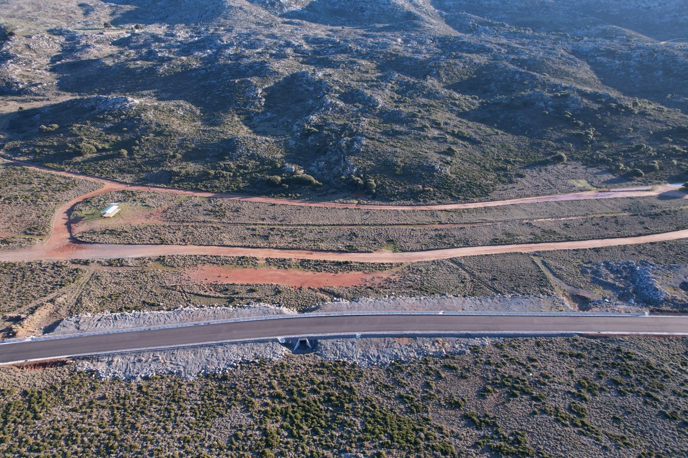
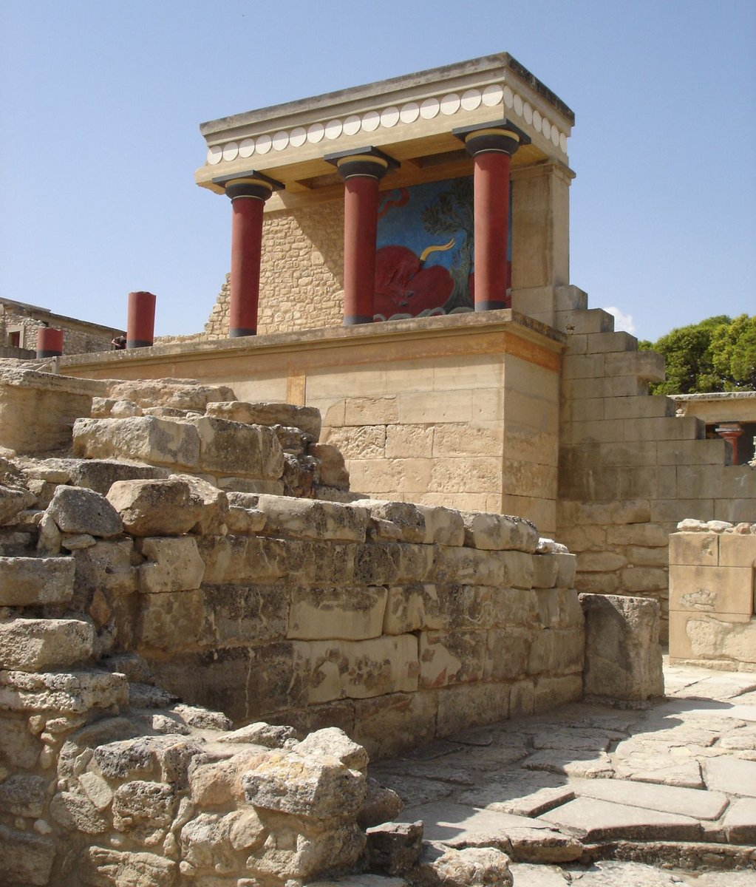
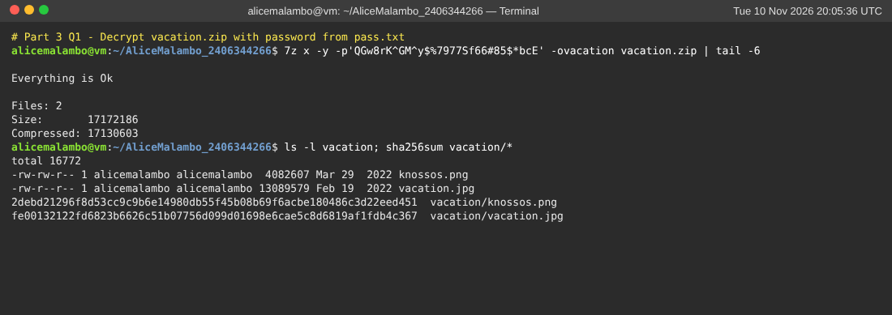
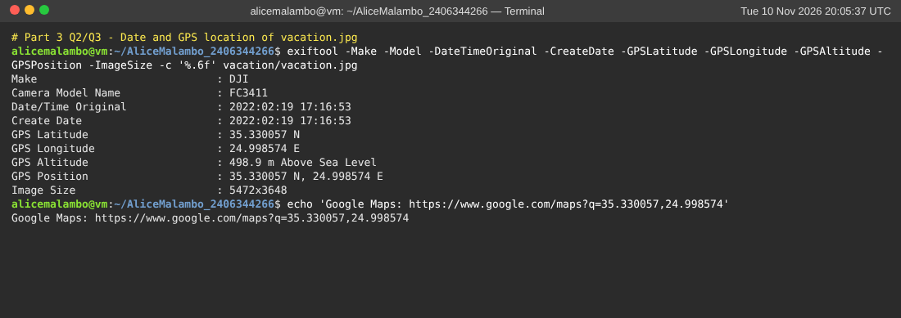
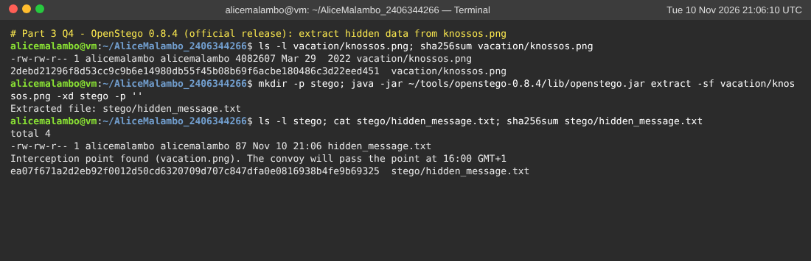
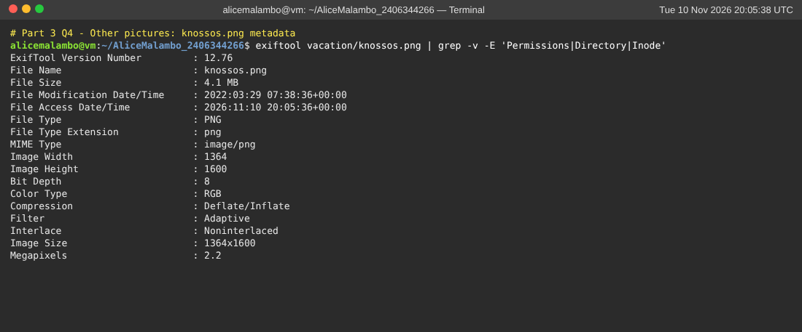
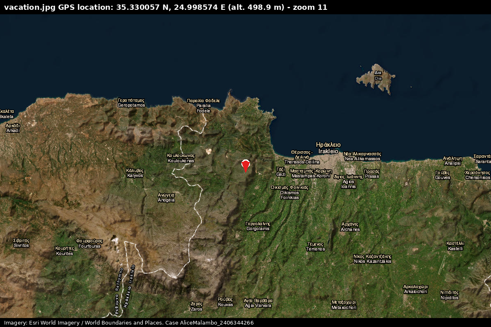
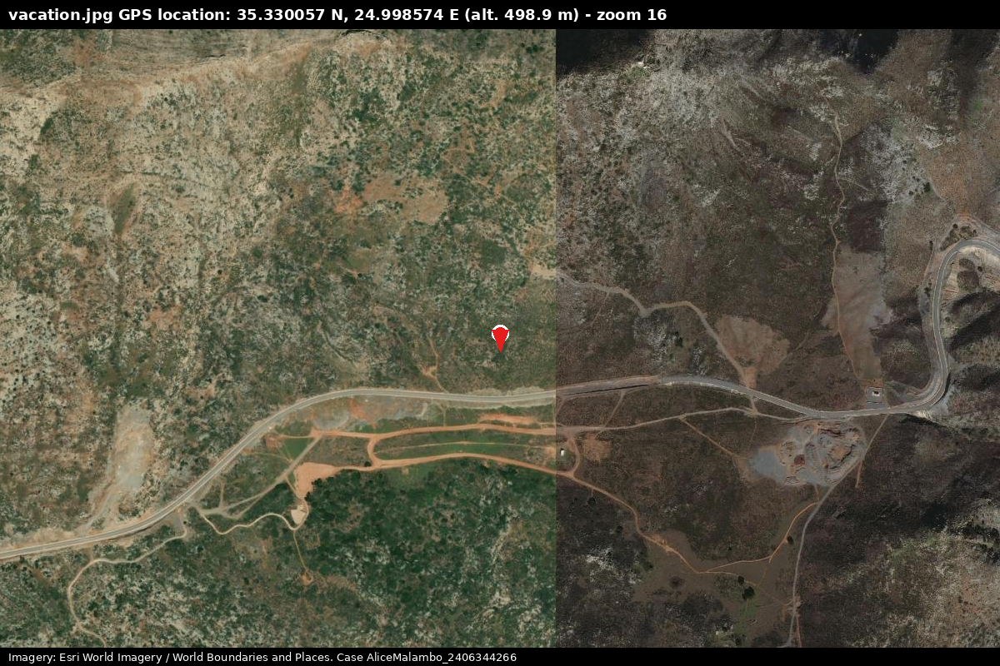
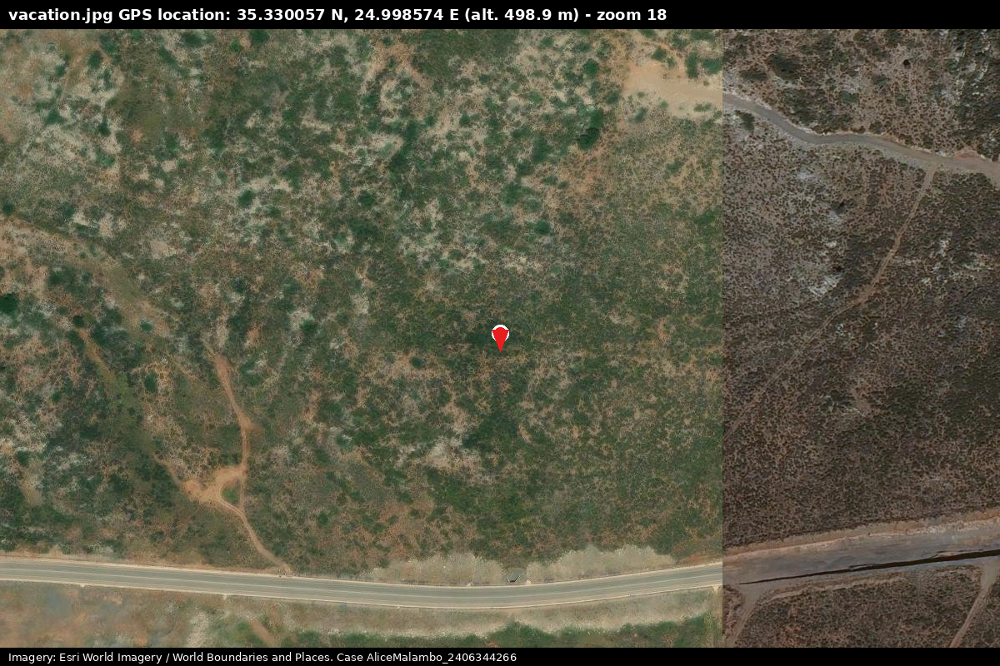

# Part 3 – Image Analysis (laptop.E01)

## 1. Decrypt the archive

Export `C:\Users\Charles Kingston\Pictures\vacation.zip` from Autopsy
(right-click → *Extract File(s)*) into `AliceMalambo_2406344266/export`, then:

```bash
7z l -slt vacation.zip            # shows: Method = AES-256 Deflate, Encrypted = +
7z x -p'QGw8rK^GM^y$%7977Sf66#85$*bcE' vacation.zip -ovacation
sha256sum vacation/*
```

(On Windows: 7-Zip → *Extract* → enter the password. The built-in Windows
ZIP tool cannot open AES-encrypted archives.)

The password is the **"archive"** entry from the `pass.txt` file recovered in
step 2.6: `QGw8rK^GM^y$%7977Sf66#85$*bcE`. The archive decrypts successfully:

| File | Size | Modified (ZIP) | SHA-256 |
|---|---|---|---|
| vacation.jpg | 13,089,579 B | 2022-02-19 16:02:13 | fe00132122fd6823b6626c51b07756d099d01698e6cae5c8d6819af1fdb4c367 |
| knossos.png | 4,082,607 B | 2022-03-29 07:38:36 | 2debd21296f8d53cc9c9b6e14980db55f45b08b69f6acbe180486c3d22eed451 |

## 2. Date of vacation.jpg

```bash
exiftool vacation.jpg
```

(Or Autopsy → *Data Artifacts → EXIF Metadata* when you add the extracted
files as a *Logical Files* data source. On Windows you can also use
*Properties → Details*.)

```
Make                 : DJI
Camera Model Name    : FC3411
Date/Time Original   : 2022:02:19 17:16:53
Create Date          : 2022:02:19 17:16:53
GPS Latitude         : 35.330057 N
GPS Longitude        : 24.998574 E
GPS Altitude         : 498.9 m Above Sea Level
Image Size           : 5472x3648
```

**The photo was taken on 19 February 2022 at 17:16:53** (camera local time).
This is more than a month **before** the suspect's laptop activity
(28–29 March 2022), so he had been in Crete, or had received the photo,
well before his "tourist" trip was supposedly taking place.

The camera is a **DJI FC3411**, the camera module of the **DJI Air 2S
drone**. The picture is an **aerial drone photograph**, not a holiday
snapshot.

## 3. Location of vacation.jpg

**GPS: 35.330057 N, 24.998574 E, altitude ≈ 499 m.**

Google Maps link to open and screenshot:
**https://www.google.com/maps?q=35.330057,24.998574**
(type `35.330057, 24.998574` in the Google Maps search box, switch to
*Satellite* view, and take the screenshot with your browser window visible).

Interpretation:
- The point is in the **hills about 13 km west of Heraklion, Crete**, in
  the mountainous area west of the city.
- The photo shows, from about 500 m altitude:
  - a **newly paved road**, with fresh cut-and-fill and a drainage culvert;
  - two dirt tracks;
  - a small isolated building;
  - barren limestone hills.
- It contains nothing a tourist would photograph, such as an
  archaeological site, a beach or a town.
- It is a deliberate **aerial survey of a remote road and infrastructure**,
  the kind of reconnaissance image an intelligence officer would collect.
- Crete hosts important NATO and Greek military installations, so
  infrastructure imagery from the island is of interest to foreign services.

**Map confirmation (Figures 20–22).** The GPS coordinates were plotted on
satellite imagery (Esri World Imagery):
- **Figure 20** places the point in the hills of the Malevizi area, **about
  6 km west of Gazi and 13 km west of Heraklion (Iraklio) city centre**.
- **Figure 21** shows the same scene as the drone photo:
  - the curved **paved road** running east–west;
  - the **parallel oval dirt tracks** just south of it;
  - the **small white building** at the western end of the tracks;
  - the barren limestone hillside to the north.
- This confirms that `vacation.jpg` was taken by a drone hovering over this
  spot, looking at the road.
- Alternative: Google Maps,
  https://www.google.com/maps?q=35.330057,24.998574 (Satellite view).

## 4. Other pictures

| Image | Findings |
|---|---|
| **knossos.png** (1364×1600, 4.1 MB) | Looks like an ordinary tourist photo of the **North Entrance / Charging Bull fresco at the Palace of Knossos**. Several things make it suspicious: <br>• It is a **PNG**, the only lossless output format of OpenStego, and unusual for a camera photo. <br>• At 4.1 MB it is very large for its resolution. <br>• It has **no EXIF/camera metadata**, so it was re-saved by software. <br>• Its timestamp is 29 Mar 2022, the same day he searched for, downloaded and installed **OpenStego 0.8.4**. <br>• It was hidden inside the **AES-encrypted** archive together with the drone photo. <br>**Confirmed:** it is the **steganographic carrier** of the hidden message below. |
| Other pictures on the laptop | Only Windows Store tile logos and three small Firefox new-tab thumbnails. Nothing of interest. |

**OpenStego extraction: hidden message found (Figure 23).**

The official OpenStego 0.8.4 release (the same version the suspect
installed) was used:

```bash
java -jar openstego-0.8.4/lib/openstego.jar extract -sf vacation/knossos.png -xd stego -p ''
#  Extracted file: stego/hidden_message.txt
cat stego/hidden_message.txt
```

```
Interception point found (vacation.png). The convoy will pass the point at 16:00 GMT+1
```

SHA-256 of `hidden_message.txt`:
`ea07f671a2d2eb92f0012d50cd6320709d707c847dfa0e0816938b4fe9b69325`

- `knossos.png` was a **steganographic carrier**. The message was embedded
  with OpenStego and **no password** (OpenStego's GUI accepts an empty
  password). Hiding it inside a tourist photo, inside an AES-encrypted ZIP,
  was the concealment.
- The message refers to the other picture:
  - **`vacation.png/jpg`, the DJI drone photo at 35.330057 N, 24.998574 E,
    is the "interception point"**, the remote paved road west of Heraklion
    shown in Figures 20–22;
  - **a convoy will pass that point at 16:00 GMT+1**.
- This turns the case from tourism into **operational intelligence**. The
  suspect scouted a location on a road with a drone and reported when a
  convoy (probably military or government) would pass. He hid the report
  with steganography and encryption, and e-mailed it to a ProtonMail
  contact.

(An earlier statistical LSB check with a custom script was inconclusive. As
expected, a short RandomLSB payload cannot be detected statistically, which
is why extraction with the tool itself was necessary.)

**Exfiltration of the archive (found with Autopsy, Figures 24 and 40):**
- An identical copy of the archive, `vacation[7].zip` (same MD5), is in the
  **Windows Mail attachments folder**.
- The Mail store holds the accompanying message to
  **alison_choi@protonmail.com**: "here are some beautiful pictures … You
  will find them interesting".
- The drone reconnaissance photo (the interception point) and the stego
  image carrying the convoy timing were therefore sent to a third party over
  ProtonMail, disguised as holiday photos.

**Conclusion of Part 3:**
- The "vacation" archive on the laptop is protected with a strong password,
  and that password was hidden on a USB stick in his hotel room. The archive
  contains:
  - a **covert drone reconnaissance photo** of remote infrastructure west of
    Heraklion, with precise GPS;
  - a tourist-looking **Knossos image carrying a hidden OpenStego message**:
    *"Interception point found (vacation.png). The convoy will pass the point
    at 16:00 GMT+1"*.
- He e-mailed the archive to alison_choi@protonmail.com as "holiday
  pictures".
- Together with the other evidence, this is strongly inconsistent with his
  claim of being a tourist and supports the suspicion of espionage:
  - the hotel searches;
  - his interest in military news (the F-35 article);
  - the use of steganography and encryption to report a convoy interception point and time;
  - the deliberate deletion of the password file.

### Image previews





## Screenshots















